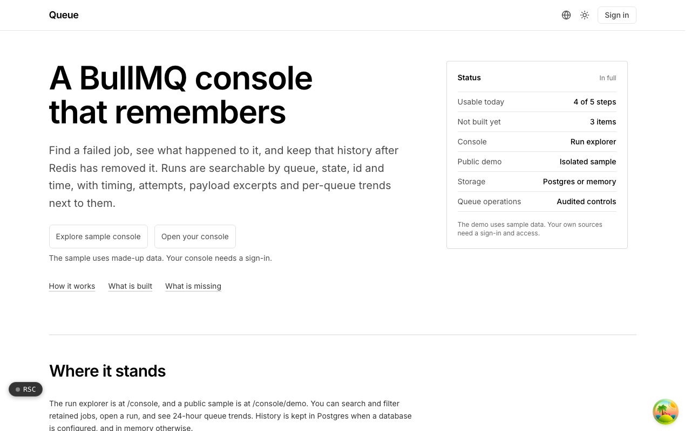

  <picture>
    <source media="(prefers-color-scheme: dark)" srcset=".github/assets/hero-dark.png">
    
  </picture>

# queue.me.at

A BullMQ console that remembers.

Queue is a run explorer and operations workspace for BullMQ. Find a failed job, see what happened to it, and keep that history after Redis has removed it. It is built for teams running BullMQ in production who need retained job history, per-queue trends and safe, audited controls, with read-only access as the default.

## Features

- **Retained run history**: settled jobs are kept past Redis eviction, within retention windows and row ceilings.
- **Run explorer**: filter runs by queue, state, id, search text and time, with cursor pagination and shareable URLs for filters and selected runs.
- **Run detail**: timing, attempts, errors and bounded payload excerpts for each run.
- **Queue metrics**: 24-hour per-queue trends next to the runs.
- **Audited operations**: retry, pause and resume, concurrency controls, recurring schedules and workflow triggers, each requiring admin permission and explicit queue confirmation.
- **Durable workflows**: a BullMQ worker runs validated workflow steps with checkpoints stored in the job, so completed steps can be reused on retry.
- **Public sample console**: an isolated demo with made-up data that needs no account, database or Redis connection.
- **Encrypted sources**: source connection URLs are stored as AES-256-GCM ciphertext, and rendered labels omit credentials.

## Built with

- Next.js 16 (App Router) and React 19
- TypeScript
- Tailwind CSS 4
- BullMQ and ioredis
- Drizzle ORM and Postgres (with an explicitly labeled in-memory fallback)
- Better Auth (shared me.at account)
- Bun for the standalone worker CLI

## Part of the me.at family

queue.me.at is one of my [`*.me.at`](https://me.at) apps. They share one design system, account, and app shell. Development happens in a private monorepo; this repository is the project's public-facing home.

## License

See [LICENSE](LICENSE).
