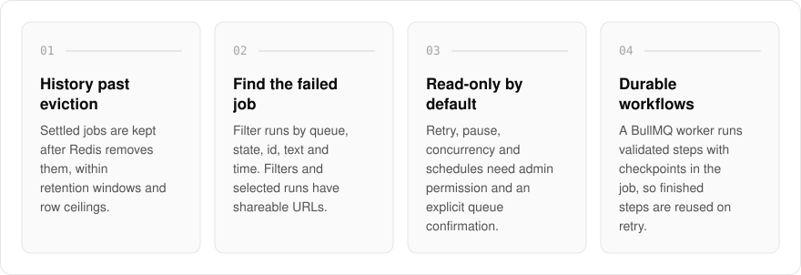
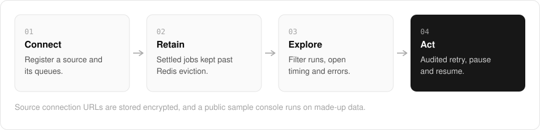

  <picture>
    <source media="(prefers-color-scheme: dark)" srcset=".github/assets/hero-dark.png">
    
  </picture>

<h1 align="center">queue.me.at</h1>

<strong>A BullMQ console that remembers.</strong>

  
  
  

  <a href="#features">Features</a> ·
  <a href="#how-it-works">How it works</a> ·
  <a href="#built-with">Built with</a>

Once Redis removes a settled BullMQ job, the failure you were trying to explain goes with it. I built queue.me.at as a run explorer and operations workspace for BullMQ that keeps that history: find a failed job, see what happened to it, and still have the record after Redis has let it go. It is for teams running BullMQ in production who need retained job history, per-queue trends and safe, audited controls, with read-only access as the default.

  <picture>
    <source media="(prefers-color-scheme: dark)" srcset=".github/assets/overview-dark.svg">
    
  </picture>

## Why queue.me.at

| The usual BullMQ dashboard | queue.me.at |
| --- | --- |
| Shows only what Redis still holds | Keeps settled runs past eviction, within retention windows |
| A snapshot of right now | 24-hour per-queue trends next to the runs |
| Every action one click away | Read-only by default; operations need admin permission and a queue confirmation |
| Filters lost on refresh | Shareable URLs for filters and selected runs |

## Features

- **Retained run history**: settled jobs are kept past Redis eviction, within retention windows and row ceilings.
- **Run explorer**: filter runs by queue, state, id, search text and time, with cursor pagination and shareable URLs for filters and selected runs.
- **Run detail**: timing, attempts, errors and bounded payload excerpts for each run.
- **Queue metrics**: 24-hour per-queue trends next to the runs.
- **Audited operations**: retry, pause and resume, concurrency controls, recurring schedules and workflow triggers, each requiring admin permission and explicit queue confirmation.
- **Durable workflows**: a BullMQ worker runs validated workflow steps with checkpoints stored in the job, so completed steps can be reused on retry.
- **Public sample console**: an isolated demo with made-up data that needs no account, database or Redis connection.
- **Encrypted sources**: source connection URLs are stored as AES-256-GCM ciphertext, and rendered labels omit credentials.

## How it works

  <picture>
    <source media="(prefers-color-scheme: dark)" srcset=".github/assets/flow-dark.svg">
    
  </picture>

You register a source and the queues it declares, with read-only access by default. Settled jobs are retained in Postgres past Redis eviction, as bounded payload excerpts rather than full copies, and history queries filter and page in the database. From a run you can see timing, attempts and errors, and an admin can retry, pause or resume after confirming the queue, with every action audited.

## Built with

  
  
  
  
  
  
  

- Next.js 16 (App Router) and React 19
- TypeScript
- Tailwind CSS 4
- BullMQ and ioredis
- Drizzle ORM and Postgres (with an explicitly labeled in-memory fallback)
- Better Auth (shared me.at account)
- Bun for the standalone worker CLI

## Part of the me.at family

queue.me.at is one of my [`*.me.at`](https://me.at) apps. They share one design system, account, and app shell. Development happens in a private monorepo; this repository is the project's public-facing home.

## License

Source-available. See [LICENSE](LICENSE).
